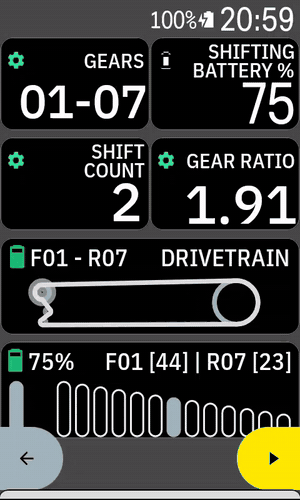
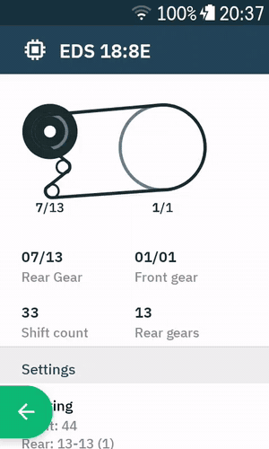
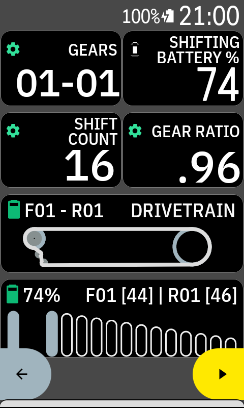
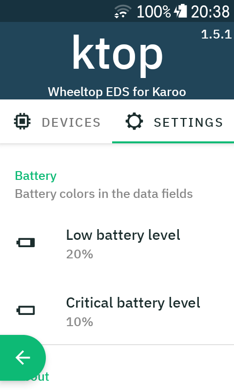

# ktop

ktop is an extension for Hammerhead Karoo bike computers that brings
**Wheeltop EDS** electronic groupsets (EDS OX, OX2, TX, GeX) to Karoo:
live gear, shift counts and battery levels as Karoo data fields, plus a
companion app to manage the groupset.

> **Status: early test version (0.x).** Things may break. Please report
> problems with a logcat (see below).

Inspired by and partly based on [Ki2](https://github.com/valterc/ki2) by
Valter C. (MIT License) — the data fields, graphical views and app layout
follow Ki2 as closely as possible.

## Screenshots

| Ride page: KI2-style data fields | App: device details |
|:---:|:---:|
|  |  |
| [video (mp4)](docs/media/ride-fields.mp4) | [video (mp4)](docs/media/app-device-details.mp4) |

| Data fields | App settings |
|:---:|:---:|
|  |  |

## Features

- Connects to the Wheeltop EDS rear derailleur over Bluetooth LE and keeps
  the connection shared between Karoo and the app.
- Karoo data fields (same set as Ki2):
  - Text: Rear Gear, Front Gear, Gears (`01-06`), Gears T, Rear/Front
    Gear T, Gear Ratio, Shift Count, F/R Shift Count, Shifting Battery %
  - Graphical: Gears Index / Size, Gears Detailed, Drivetrain Index / Size,
    Bike Battery
  - Additionally: battery voltage of rear derailleur, front derailleur and
    both shifters
- Companion app:
  - Manage several Wheeltop groupsets (add by scan, rename, reorder, remove)
  - Device details: live drivetrain view, gears, batteries (RD, FD, left
    and right shifter), firmware versions
  - **Race mode** and **sleep mode** switches
  - Custom gearing (teeth counts) per device for Gears T / Gear Ratio
  - Battery warning levels
- English and German (follows the Karoo language setting)

## Requirements

- Hammerhead Karoo with extension support (karoo-ext 1.1.x)
- Wheeltop EDS groupset (OX, OX2, TX or GeX)

## Installation

1. Download `ktop.apk` from the
   [latest release](../../releases/latest).
2. Sideload it to the Karoo
   ([Hammerhead: Companion App Sideloading](https://support.hammerhead.io/hc/en-us/articles/31576497036827-Companion-App-Sideloading)),
   e.g. by sharing this link with the Hammerhead Companion app:
   `https://github.com/geowiwi/ktop/releases/latest/download/ktop.apk`
3. Open **ktop** on the Karoo once and allow Bluetooth access.
4. Wake the groupset (shift once or move the bike), press **+** in the
   *Devices* tab and **Add** your groupset.
5. In Karoo: **Sensors → + → Extensions → Wheeltop (EDS)** and add the
   groupset.
6. Add the ktop data fields to your ride profile pages.

Updates: Karoo checks GitHub for new ktop releases and offers them for
installation (pre-releases are not offered).

Optional: open the device in ktop → **Gearing** and enter the chainring
and cassette teeth (Wheeltop EDS does not report teeth counts). Needed for
Gears T, Gear Ratio and the "Size" views.

## Battery and runtime

Rough numbers to plan with; none of them are measured by ktop itself.

| | Figure | Source |
|---|---|---|
| RD battery | about 800 mAh, USB-C | [BikeRadar](https://www.bikeradar.com/advice/buyers-guides/wheeltop-buyers-guide) (EDS TX / OX2) |
| Manufacturer claim | up to 20,000 shifts per charge | BikeRadar (EDS TX) |
| Rider report | about 20 % in a 4 h ride at 400–500 shifts/h, i.e. roughly 20 h per charge | [TrainerRoad forum](https://www.trainerroad.com/forum/t/wheeltop-eds-tx-1000-mile-review-updated-3k-mile-thoughts/103636) |

Rule of thumb: runtime ≈ shifts per charge ÷ your shifts per hour. With
the rider report above (about 9,000 shifts per charge) that is about 45 h
at 200 shifts/h and about 20 h at 450 shifts/h. The manufacturer claim
would roughly double that.

What changes the consumption:

- **ktop keeps the RD awake while it is connected.** The RD never sleeps
  while an app is connected (it normally sleeps 3 min after the last
  shift). While riding this makes no difference; on long stops with the
  Karoo still connected, the RD stays awake. ktop reads the batteries
  every 30 s.
- **Race mode** shifts faster and drains the RD battery faster.
- **Sleep mode off** keeps the RD awake when idle and drains it faster.
- A front derailleur (EDS TX) has its own battery.

How ktop shows battery levels: the RD/FD percentage is a straight line
between 6.6 V (0 %) and 8.2 V (100 %), the shifter coin cells between
2.0 V and 3.2 V. These are estimates, not a fuel gauge; use the voltage
fields if you want the raw values.

Measure your own runtime: note **Shifting Battery %** and **Shift Count**
at the start and end of a ride; % used per shift tells you how many
shifts a full charge gives you.

## Known limitations

- Teeth counts must be entered manually (see above).
- Battery percentages are estimated from voltage (linear approximation).
- Front derailleur position (2x, EDS TX) is implemented from the protocol
  documentation but not yet tested on a real 2x system.
- Ki2's "Shifting Mode" field is Shimano-specific and not available.
- Fields that were added to a profile with an older ktop version may need
  to be removed and added again.
- Shifter buttons cannot be remapped to Karoo actions (e.g. next page)
  yet: the shifters talk only to the rear derailleur, and the derailleur
  does not report button presses to apps. Being investigated.
- Tested with EDS GeX firmware RD 2.67, shifters L 3.25 / R 4.30,
  ANT 6.2. Newer Wheeltop firmware (e.g. the August 2026 update) is not
  tested yet; please report your firmware versions (shown in the device
  details) with any problem.

## Reporting problems

Please open an issue and attach a logcat filtered by `ktop-ble`
(Android Studio *Logcat* or `adb logcat -s ktop-ble`), plus your groupset
model and what you did. For raw protocol frames also include the
`ktop-raw` tag (`adb logcat -s ktop-ble ktop-raw`).

## Credits

- [Ki2](https://github.com/valterc/ki2) by Valter C. — data field set,
  views (GearsView, DrivetrainView, BatteryView, FillView), layouts, app
  structure. MIT License, see `LICENSE-ki2.txt`.
- [eds-ox](https://git.jeckyll.net/published/personal/eds-ox) — reverse
  engineered Wheeltop EDS Bluetooth protocol and reference app.
- [karoo-ext](https://github.com/hammerheadnav/karoo-ext) by Hammerhead.

Wheeltop and Karoo are trademarks of their respective owners. This project
is not affiliated with Wheeltop or Hammerhead.

## License

MIT — see `LICENSE`.
